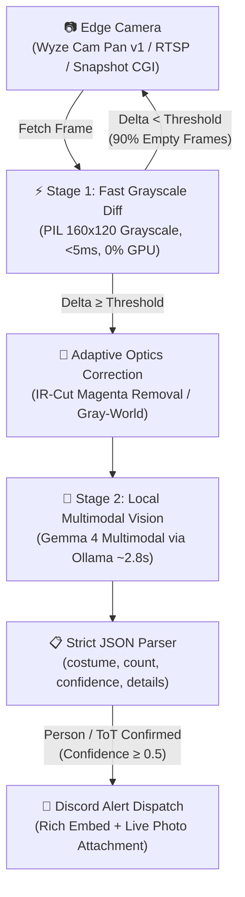

# 🎃 Trick-or-Treat Sentry: Zero-Cloud Edge AI Costume & Visitor Detection

[](https://www.python.org/)
[](https://ollama.ai)
[](LICENSE)
[](#)

A real-time, privacy-first **Edge AI trick-or-treater and visitor sentry**. Built for Halloween night, it pairs a low-power edge camera (such as a liberated 2.5W Wyze Cam Pan v1 running open-source Ingenic T20 MIPS Linux firmware) with a local multimodal vision model (`Gemma 4`) running on a local homelab GPU to classify approaching trick-or-treaters, describe their costumes, and send instant photo alerts to Discord.

**Zero cloud subscriptions. Zero video streams leaving your home network. $0.00 in API tokens.**

---

## ⚡ Architecture & Signal Pipeline

Running continuous multimodal vision on high-resolution video 24/7 wastes massive electrical power and GPU cycles. Trick-or-Treat Sentry solves this with a **tiered, low-power perception pipeline**:



1. **Stage 1 Micro-Tripwire (`<5ms`, 0% GPU):** Downsamples incoming frames to 160x120 grayscale and calculates a histogram pixel difference against a rolling adaptive background. 90%+ of empty or static frames are rejected without waking the GPU.
2. **Adaptive Optics / IR Cast Correction:** When cameras shoot through porch windows or switch IR cut filters, scenes often suffer from heavy magenta/purple color casts. An automated white-balance filter neutralizes IR glare to preserve true costume colors.
3. **Stage 2 Local Multimodal Vision (~2.8s):** Dispatches the raw frame to local `gemma4:e2b-it-q4_K_M` running via Ollama (`keep_alive="15m"`, `think=False`). The model outputs structured JSON with:
   - `person_approaching` (`bool`)
   - `is_trick_or_treater` (`bool`)
   - `count` (`int`)
   - `costumes` (`str`, e.g. "Ghost costume", "Purple hooded outfit")
   - `details` (`str`)
   - `confidence` (`float`)
4. **Stage 3 Discord Push Notification:** Sends a rich webhook/bot alert with Halloween Pumpkin Orange theme (`#FF7518`), visitor count, costume description, and the full-resolution photo attachment directly to your phone.
5. **Adaptive Rolling Cooldown:** Implements a debounce lock so visitors walking up the steps don't trigger repeated duplicate notifications.

---

## 📊 Real Halloween Production Benchmarks

Empirical performance metrics recorded during Halloween night operations:

| Metric | Measured Value |
| :--- | :--- |
| **Total Frames Analyzed** | 1,683 frames |
| **Multimodal Vision Inferences** | 150 local inferences |
| **Confirmed Alerts Dispatched** | 20 real-time Discord notifications |
| **Trick-or-Treater Batches Detected** | 6 confirmed groups |
| **Average Vision Inference Latency** | **2.85 seconds** (RTX 2080 8GB) |
| **Fastest Inference** | 1.47 seconds |
| **Total Cloud API Tokens Consumed** | **0 tokens ($0.00)** |
| **Notable Costumes Identified** | Ghost, purple hooded cloak, tutu/fairy dress, robe & suit with candy bag |

---

## 🚀 Quickstart

### 1. Prerequisites
- Python 3.10+
- [Ollama](https://ollama.ai) installed and running locally
- Pull the local vision model:
  ```bash
  ollama pull gemma4:e2b-it-q4_K_M
  ```
- Any camera offering an HTTP snapshot endpoint or RTSP feed (e.g. Wyze Cam with Dafang-Hacks / `wz_mini_hacks`, Reolink, Amcrest, or standard IP camera).

### 2. Installation
```bash
git clone https://github.com/Benfinkels/trick-or-treat-sentry-.git
cd trick-or-treat-sentry
pip install -r requirements.txt
```

### 3. Configuration
Copy `.env.example` to `.env` and fill in your details:
```bash
cp .env.example .env
```
```ini
WYZE_CAM_URL="http://192.168.1.50/cgi-bin/currentpic.cgi"
WYZE_CAM_USER="admin"
WYZE_CAM_PASS="your_password"

DISCORD_TOKEN="your_bot_token"
DISCORD_CHANNEL_ID="your_channel_id"

MOTION_THRESHOLD="3.0"
ALERT_COOLDOWN_SEC="30"
```

### 4. Test Notification Pipeline
Verify your Discord webhook and camera frame capture before going live:
```bash
python sentry.py --test-alert
```

### 5. Run Live Sentry
```bash
python sentry.py
```

---

## 🧪 Running Tests

The test suite validates frame differencing, IR color correction, and environment parsing:
```bash
pytest -v
```

---

## 🛠️ Systemd Daemon Setup (Linux)

To run the sentry as an unattended background service on a home server:
```bash
# Copy and enable user systemd service
cp systemd/trick-or-treat-sentry.service ~/.config/systemd/user/
systemctl --user daemon-reload
systemctl --user enable --now trick-or-treat-sentry.service

# View live logs
journalctl --user -u trick-or-treat-sentry.service -f
```

---

## 🔒 Privacy & Zero-Cloud Guarantee

Unlike commercial smart doorbells (Ring, Nest, Blink):
- **No cloud video storage:** Your camera frames never leave your local LAN.
- **No subscription fees:** Operates completely free of monthly charges.
- **Local intelligence:** Classification and vision analysis happen on your own hardware.

---

## 📄 License

MIT License. See [LICENSE](LICENSE) for details.
